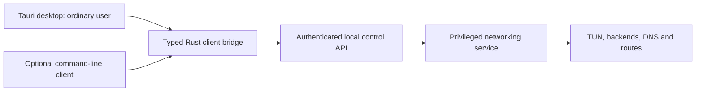

<!--
SPDX-FileCopyrightText: 2026 skunkie

SPDX-License-Identifier: MIT
-->

# Service and Desktop Client

Status: product and architecture contract; the service, control API, and
Tauri application are not implemented yet. [ADR 0004](adr/0004-desktop-service.md)
records the decision. The desktop client replaces the planned terminal UI.

## 1. Product Model

One installed application provides two independent processes: an ordinary-
user Tauri 2 client and a privileged Rust networking service. The service
owns TUN devices, backend connections, DNS/routing transactions, metrics,
recovery, and reconnects. The client sends typed commands and observes state.
An optional terminal window is not required for normal use.

The original application's purpose and supported tunnel protocols remain
the compatibility target. RFCs define wire behavior; they do not define UI,
route precedence, route grace, or local authorization policy. SSH trust,
strict validation, deterministic routing, IPv6 fixes, and the service-binding
policy remain documented intentional differences. Do not market the result
as identical behavior solely because libraries implement RFCs.

The first release has one managed configuration per host network namespace,
containing all configured backends. Multiple profiles and per-user tunnels
are later work; the desktop must explain that Connect/Disconnect affects
the host's selective routing, not only the application's own traffic.



## 2. First Launch and Daily UX

1. On macOS, open the app from its installed location. Explain the networking
   service's purpose and register it through native Service Management.
   Show approval-pending, denied, missing, and ready states separately; open
   the relevant System Settings page when the user chooses to grant approval.
   Never request an administrator password in a web form.
2. Import an existing `~/.warp.yaml` or create a configuration through guided
   forms. Preserve an advanced YAML view. Resolve file references in the
   ordinary-user native client, validate without changing networking, and
   display actionable errors and SSH trust requirements before Connect.
3. Install an approved managed snapshot and enroll its authorized owner
   through a platform administrative authorization flow. Registration alone
   does not authorize arbitrary IPC callers or arbitrary configuration paths.
4. Default to disconnected with Connect visible. Service availability and
   tunnel connectivity are different statuses. Starting the GUI never
   silently connects or changes boot policy.
5. Connect requests a supervised session; show its actual phase, backend
   health, and routing/DNS readiness. Disconnect explicitly tears it down.
   Closing a window or choosing Quit closes the client and leaves the
   service/session running. A separate Disconnect action is always available.
6. Offer Connect at startup as an explicit preference, default off. Explain
   its scope separately from opening the desktop at login. Reopening the
   GUI attaches to the current session instead of creating a second TUN.

The main view shows connection state and actions, backend health, traffic,
and the latest actionable error. Routes, connections, and redacted logs are
secondary views. Configuration forms explain unsupported UDP, DNS conflicts,
and service-binding target restrictions in plain language. An Explain action
shows configuration/current-snapshot decisions without initiating DNS or
traffic. Do not imply a full-device kill switch.

Configuration changes are validated as a candidate before installation.
Initially, installing a new networking configuration requires a disconnected
session; return a clear Busy result while active instead of silently
restarting tunnels. Saved UI preferences are per-user and unprivileged.
Full live networking reconfiguration remains outside initial scope.

## 3. Process, Lifecycle, and State Ownership

- `warperd` is a foreground Rust service supervised by systemd on Linux and
  launchd on macOS. Do not double-fork. The GUI is a separate Tauri executable;
  the optional `warper` CLI uses the same control protocol.
- The service alone holds the network-instance lock and recovery journal.
  No GUI/CLI process independently cleans up or starts a competing network
  engine. Foreground developer operation of `warperd` uses the same lock.
- Control readiness means the local API can report state. Session readiness
  means the selected backends, packet handlers, exemptions, capture routes,
  and DNS publication passed their separate readiness barrier. Recovery may
  be visible through the API, but Connect is blocked until it succeeds.
- Distinguish missing service, approval required, idle, connecting, connected,
  degraded, disconnecting, error, and recovery required in the UI. Transport
  loss makes observations stale; it never produces a false Connected state.
- The service serializes desired connection state and configuration
  generations. Repeated Connect/Disconnect requests are idempotent. A client
  timeout/disconnection cancels observation, not an accepted operation.
  Disconnect supersedes pending connection/reconnect work through explicit
  cancellation and cleanup.
- Persist desired connection state with boot identity. After a service crash
  in the same boot, reconcile stale resources before restoring that intent.
  A fresh boot starts disconnected unless `service.autoconnect` is enabled.
  An explicit Disconnect remains effective across same-boot service restarts.
- Backend outages and network/sleep-wake changes use bounded reconnects and
  existing ownership/exemption rules. Unavailable selected backends never
  cause direct fallback. The GUI may restart independently without changing
  networking.
- A service stop/shutdown drains and cleans up under its deadline. Client
  process signals affect only that client. Refuse offline recovery while the
  service owns the lock; route authorized recovery through the service when
  available, or require the stopped-service recovery command.

## 4. Local Control and Privilege Boundary

Use a shared typed logical API with a native transport adapter: XPC on macOS
and a protected Unix-domain socket on Linux. Prove macOS peer authentication
and registration in an executable native spike before relying on it. No
TCP/HTTP management listener is enabled in the initial release.

The service authenticates OS-provided peer identity; macOS release clients
must also satisfy the designated code-signing identity/allowed client roles.
Do not trust caller-supplied UID, PID, executable path, or a claimed bundle
ID. Enrollment of the managed owner and installation of configuration need
verified administrative authorization. Once enrolled, that owner can
observe state and request Connect/Disconnect without running the GUI as root.
Other users receive no tunnel metadata or control access by default.

### Initial Linux peer boundary

Linux authorization uses kernel `SO_PEERCRED` from a connected Unix stream,
after verifying its socket type/domain and connection. No caller-supplied UID,
PID, path, GID or role is accepted as proof. The reserved invalid UID value is
rejected. Reported UIDs are relative to the receiver's user namespace; unmapped
IDs can be reported as an overflow UID, which this credential snapshot cannot
distinguish from a real account. Both native client and service must validate
their receiving UID namespace before interpreting UID 0 as the host service or
host administrator. Initial-namespace admission must inspect the current thread
through fixed `/proc`, verify procfs and a symlink descriptor, and resolve
`thread-self/ns/user` with openat2 beneath/no-mount-crossing/no-magic-link guards.
Only the kernel initial-user-namespace identifier is accepted; missing or
unverifiable evidence fails closed without a weaker fallback. This requires
Linux openat2 support (5.6 or newer). PID 1, namespace-parent EPERM, environment
overrides and identity-looking uid_map text are not admission evidence.
Admission is repeated before producing peer credentials on both endpoints;
the bare policy evaluator is internal. The service must not change its user
namespace between authorization and the corresponding privileged operation.
Credential snapshots describe connection establishment; they do
not prove current process liveness or code identity.
An authorized process may delegate an established descriptor; this is not an
executable-identity sandbox.

With an enrolled owner UID loaded from protected service state, that owner may
observe and request Connect/Disconnect. UID 0 may also perform administrative
operations. Without an enrolled owner, only UID 0 is authorized. Foreign peers
receive the same PermissionDenied result regardless of enrollment state; errors
do not contain the owner UID or peer PID. Owner enrollment/replacement,
configuration installation and administrative recovery require UID 0 in this
initial Linux policy. This does not enroll anyone or persist policy by itself.

Clients must verify a UID-0 service peer before sending configuration/material.
That check is necessary but not sufficient: trusted UID namespaces, a fixed
protected socket location, safe listener ownership/cleanup, version negotiation
and bounded messaging are still required before any control request or secret
transmission. No service
listener or administrative mutation is introduced by the peer-check library.
Protected owner storage and enrollment remain independent implementation gates.

The Linux peer adapter is unavailable on macOS. UID-only checks must never
substitute for the code-identity and mutual-authentication requirements in
ADR 0005; until that native adapter exists, return UnsupportedIntegration.

### Linux runtime ownership boundary

`RuntimeLease` implements initial exclusive ownership of the fixed protected
runtime directory and persistent `service.lock`, as specified in
[configuration](configuration.md#linux-service-runtime-ownership) and ADR 0009.
It requires initial-user-namespace UID 0; verifies directory/file metadata and
names through pinned descriptors; acquires nonblocking flock; and preserves the
lock inode when releasing ownership. Later mutations must first revalidate the
lease. No arbitrary path or ordinary-user ownership override is exposed.

The lock is advisory; administrators are trusted, and this does not establish
mount/network namespace admission. It is not yet integrated into `warperd`.
The endpoint adapter now publishes a fixed listener only after synced intent,
returns only kernel-authorized peers, and explicitly retires unchanged owned
socket/intent state. Drop preserves uncertain state; existing objects are never
automatically removed. See the [endpoint contract](configuration.md#linux-control-endpoint).
The fixed protected owner store now implements atomic revisioned enrollment,
replacement/removal with native administrative authorization, durable staging
and uncertain-commit reporting. See the
[storage contract](configuration.md#linux-owner-enrollment-storage).
The Linux client now verifies and pins the fixed protected endpoint, connects
with a deadline/cancellation owner and authenticates the real root service
before returning a stream. It sends no payload during admission. Explicit
administrative inspection/discard now recovers unchanged pending enrollment
without granting its proposed owner; committed policy remains intact. Session
handlers, live revocation and service integration remain open.

### Initial control wire framing

The shared Rust framing adapter uses a 20-byte big-endian header: `WRPC`, u16
version 1, u16 kind, u32 body length, and nonzero u64 request ID. Unknown magic,
version, kind, zero request IDs and invalid kind-specific lengths fail before
body allocation. Bodies admit at most 1 MiB plus eight bytes of generation metadata; fixed
commands have exact sizes.
No raw path, shell or generic file command exists. Frame Debug is redacted.

Kind values are Hello=1, Status=2, Connect=3, Disconnect=4, Enroll=5,
InspectRecovery=6, InstallConfig=7 and OperationStatus=8. Replies are
HelloReply=0x8001, StatusReply=0x8002, Accepted=0x8003,
EnrollmentReply=0x8005, RecoveryReply=0x8006, ConfigReply=0x8007,
OperationReply=0x8008 and ErrorReply=0xffff. The framing layer is not a handler:
unsupported operations must still return a typed unsupported response.

Hello/Status/InspectRecovery have empty bodies; HelloReply has a nonzero
16-byte instance ID. Connect/Disconnect carry a nonzero 16-byte operation ID
and u64 expected configuration generation. Enroll carries u64 expected owner
revision, u32 presence and u32 UID using the enrollment record's rules.
OperationStatus and Accepted carry a nonzero 16-byte operation ID. InstallConfig
carries u64 expected configuration generation followed by 1..=1 MiB of managed
input, never a request to read a privileged path.
EnrollmentReply/ConfigReply carry nonzero u64 revisions. StatusReply is session-state
u8 (0..5), u64 configuration generation, u64 owner revision and configuration
presence u8 (0/1). RecoveryReply is a u16 bitset with only bits 0..2 defined.
OperationReply carries operation ID, state u8 (0..4) and error code u16.
ErrorReply is a nonzero error code u16. Codes are None=0, Unsupported=1,
PermissionDenied=2, Malformed=3, Busy=4, Conflict=5, RecoveryRequired=6,
Timeout=7 and Failed=8. Failed operation state 3 requires a nonzero code;
other states require None. State names are finalized with the service handlers.

Each async frame read/write uses one injected absolute deadline and cancellation
receiver covering header, body and flush. Closed cancellation channels cancel.
Malformed, cancelled, partial or timed-out streams must be closed, never resumed
or replayed. Configured `max_control_message_bytes` counts the header and generation
metadata too; `read_limited/write_limited` enforce that budget before body
allocation/output. Offline-valid source can still exceed the encoded import
budget and must be rejected explicitly. At most one admitted frame buffer per
reader is allocated; global connection limits and total buffer accounting belong to service admission.
Authenticate both endpoints before framing; require Hello before requests,
correlate replies, reauthorize every request and reuse operation identity after
an uncertain client result. The codec alone does not establish these session
or service acceptance gates.

### Control API and managed material

The API must cover status/snapshots, paginated routes/flows/logs, subscriptions,
Connect/Disconnect operations, operation status, Explain, and authorized
configuration installation/recovery. Specify version negotiation, bounded
messages/clients/requests/event queues, deadlines, operation IDs, and
configuration generations before implementing the service API.

The native client imports a normalized configuration and explicitly selected
credential/trust material using its own user access. The privileged endpoint
accepts validated data and managed credential references, never arbitrary
file-read paths, shell commands, executable names, or environment overrides.
The service atomically stores approved data in a protected managed directory.
Editing the original home file does not change the running service, and a
daemon started at boot never searches root's home or relies on `SUDO_USER`.

Expose only narrow Tauri commands to local bundled UI assets. Do not expose
generic IPC forwarding, shell execution, unrestricted filesystem access, or
remote content with native privileges. Use explicit capabilities and CSP;
render observed domains/logs as untrusted text. Keep credentials out of
snapshots, events, errors, logs, and frontend persistence. Prefer native
credential import rather than returning secret files to JavaScript.

Slow subscribers cannot block forwarding or mutation processing. Bound their
queues; disconnect or explicitly require resynchronization on loss. A client
reconnects by obtaining a fresh snapshot/cursor, not by treating cached UI
state as authoritative. An incompatible service/client version produces an
actionable update message before mutations.

## 5. macOS Distribution

Target macOS 13 or later for the modern helper API. Ship the desktop and
`warperd` in one application bundle, optionally delivered as a DMG:

```text
warper.app/
└── Contents/
    ├── MacOS/                 # Tauri desktop executable
    ├── Resources/             # Bundled assets and packaged warperd helper
    └── Library/LaunchDaemons/
        └── <service-label>.plist
```

Use a fixed reviewed service identifier. The daemon plist uses a bundle-
relative `BundleProgram`; the native client registers it with
`SMAppService.daemon(plistName:)`. Tauri custom bundle files/resources package
the artifacts; registration and OS approval provide service activation.
Launching an ordinary Tauri sidecar is not privilege elevation or persistent
service installation. Do not use a frontend shell plugin to launch it as root.

The release must sign embedded executable code and the enclosing bundle with
the appropriate Developer ID identity, notarize the distribution, and verify
the installed helper/GUI identities. Avoid broad entitlements. Keep the app
in its supported installed location before registration; test first launch,
denial/revocation, relocation, update, removal, and reboot on a clean Mac.
Development/ad-hoc builds do not establish release-installation acceptance.

Local development does not require a paid Developer ID or notarization. On
Apple Silicon, use at least an ad-hoc signature, commonly produced by the
build tools. Follow [ADR 0005](adr/0005-macos-development-authentication.md):
administratively enroll exact validated build hashes/roles and an owner UID
in a protected development installation. Enforce actual peer identity in both
directions; changed builds require explicit re-enrollment. The production
helper has no development-auth fallback. Prove this no-paid-account path
through UX-05 rather than treating a paid-signed native test as a substitute.
A standalone local launchd harness does not prove bundled registration.

Bundle updates must coordinate GUI/helper versions and active sessions. For
the initial release, an explicit update may require Disconnect, cleanup,
helper replacement/re-registration, and reconnect. Do not silently replace
privileged code while claiming existing sessions continue. Provide Remove
networking service to disconnect/clean up and unregister; explain what saved
configuration remains or is deleted. Merely moving the GUI to Trash is not
an application-controlled cleanup transaction.

Linux packages install the same core service through systemd and ship the
desktop separately as part of the installation. Native dependencies, policy,
owner enrollment, and uninstall behavior require their own packaging tests.

## 6. Implementation Gates

Keep networking stack probes first. Before production control integration,
close the API/authorization contracts with local transport tests. Before
depending on the macOS bundle design, add a minimal native helper-registration
spike that verifies approval, owner enrollment, authenticated messages, and
unregistration on macOS 13+; record unavailable signing/VM evidence honestly.
Its authentication portion must pass UX-05 with ad-hoc-signed packaged builds
and no Apple-issued developer identity. A certificate-signed run alone cannot
close that gate. Rebuild/re-enrollment and rejected-peer cases are required.
That native gate precedes macOS-dependent integration, while Linux service
and networking feasibility work can continue independently.

When the desktop code is introduced, pin its package manager and dependencies,
commit the lockfile, and add frontend unit tests, type checking, lint, and
production builds plus Tauri native/package checks. Select the renderer and
test tools explicitly then; they must not change the service/control boundary.
No placeholder frontend or successful dummy installer is required now.

NET-09 and UX-01 through UX-05 in the [acceptance contract](acceptance.md)
cover client independence, authorization, state/operations, and bundled
installation. These gates remain pending until executable evidence exists.

References: [Tauri app bundles](https://v2.tauri.app/distribute/macos-application-bundle/),
[capabilities](https://v2.tauri.app/security/capabilities/),
[macOS signing](https://v2.tauri.app/distribute/sign/macos/),
[Apple helper bundle layout](https://developer.apple.com/documentation/servicemanagement/updating-helper-executables-from-earlier-versions-of-macos),
and [SMAppService](https://developer.apple.com/documentation/servicemanagement/smappservice).
For development signing, see [Apple Silicon executable signing](https://developer.apple.com/documentation/macos-release-notes/macos-big-sur-11_0_1-universal-apps-release-notes)
and [code identity requirements](https://developer.apple.com/documentation/technotes/tn3127-inside-code-signing-requirements).
